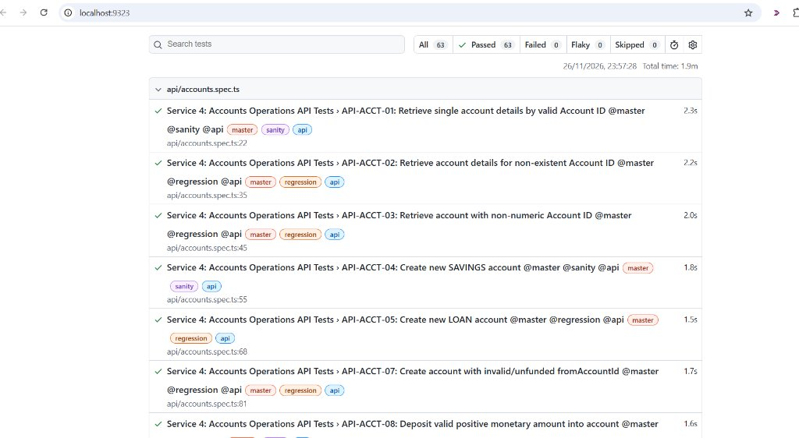
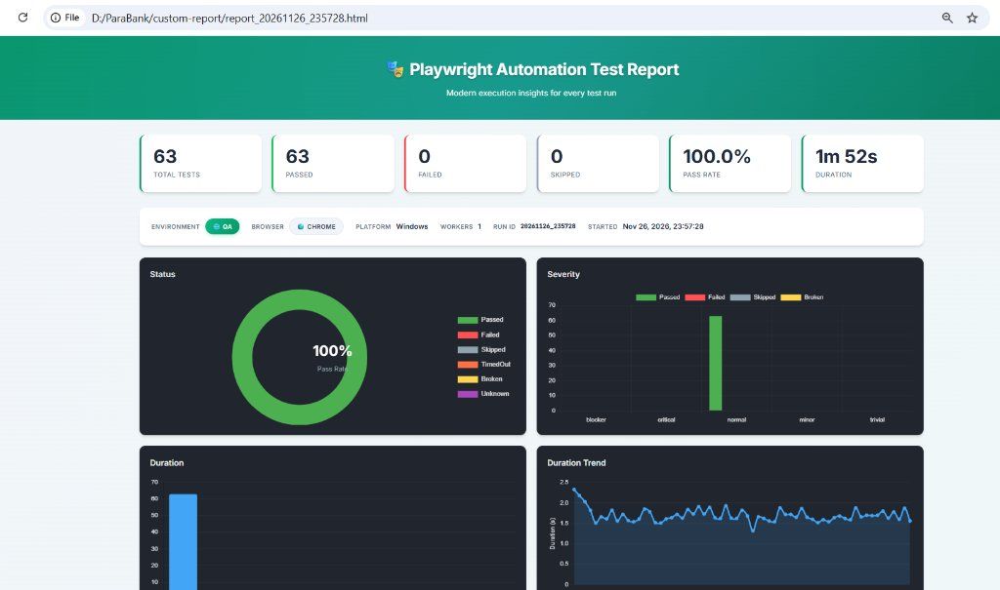
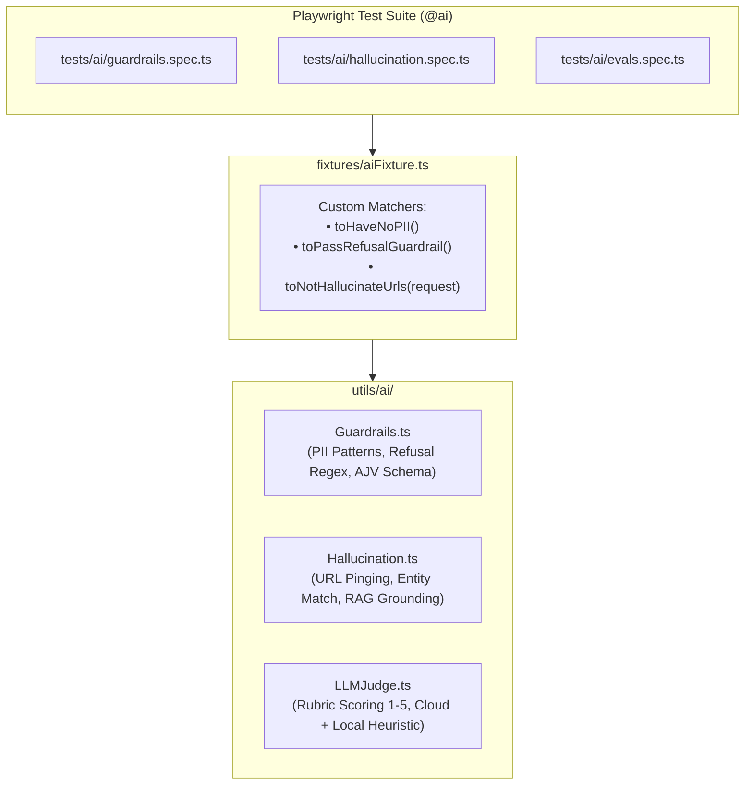
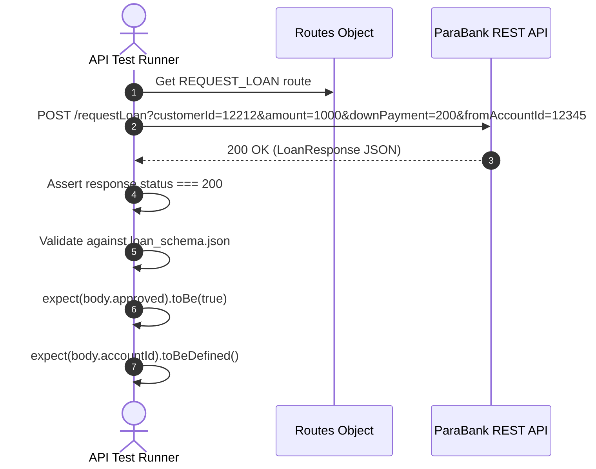
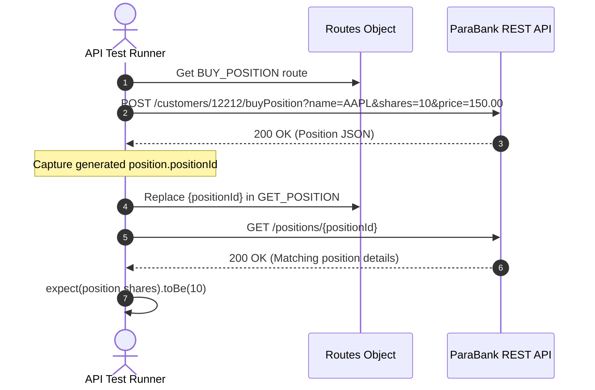

# 🏦 ParaBank REST API Playwright + TypeScript Automation Framework

A production-grade, enterprise-ready REST API test automation framework built with **Playwright**, **TypeScript**, and modern software testing design patterns for the **ParaBank Banking Platform**.

The framework delivers end-to-end coverage across all 8 core banking microservices, contract validation via compiled **AJV JSON Schemas**, performance SLA validations, security audits (IDOR & header verification), and automated burst pacing to eliminate Cloudflare WAF rate limiting.

---

## 📑 Table of Contents

- [Architecture Overview](#-architecture-overview)
- [Key Features](#-key-features)
- [Tech Stack](#-tech-stack)
- [Directory Structure](#-directory-structure)
- [ParaBank API Microservices](#-parabank-api-microservices)
- [API Contract Validation (AJV Schemas)](#-api-contract-validation-ajv-schemas)
- [Rate Limiting & Cloudflare WAF Mitigation](#-rate-limiting--cloudflare-waf-mitigation)
- [Environment Configuration](#-environment-configuration)
- [Running Tests](#-running-tests)
  - [NPM Scripts by Tag](#npm-scripts-by-tag)
  - [Run by Test Spec](#run-by-test-spec)
  - [Run with Flags (UI, Debug, Trace)](#run-with-flags-ui-debug-trace)
- [Reporting](#-reporting)
- [CI/CD & GitHub Actions](#-cicd--github-actions)
- [GenAI Testing: Evals, Hallucination Detection & Guardrails](#-genai-testing-evals-hallucination-detection--guardrails)
- [QA Agent Skills & Test Case Generation Suite](#-qa-agent-skills--test-case-generation-suite)
- [Postman API Collection for Manual Testing](#-postman-api-collection-for-manual-testing)
- [Architecture & Workflow Diagrams](#-architecture--workflow-diagrams)
- [Plan & Version Evolution History](#-plan--version-evolution-history)
- [Best Practices](#-best-practices)

---

## 🏛 Architecture Overview

```
                              ┌─────────────────────────────────────────┐
                              │         Playwright Test Runner          │
                              │           (@playwright/test)            │
                              └────────────────────┬────────────────────┘
                                                   │
                                                   ▼
                              ┌─────────────────────────────────────────┐
                              │          apiFixture (Auto-Pacing)       │
                              │      Cloudflare WAF / Burst Guard       │
                              └────────────────────┬────────────────────┘
                                                   │
                   ┌───────────────────────────────┼───────────────────────────────┐
                   │                               │                               │
                   ▼                               ▼                               ▼
       ┌───────────────────────┐       ┌───────────────────────┐       ┌───────────────────────┐
       │   Core Banking Tests  │       │  Contract / Schemas   │       │ Security & Performance│
       │     (tests/api/)      │       │   (tests/api/schemas) │       │ (security-performance)│
       └───────────┬───────────┘       └───────────┬───────────┘       └───────────┬───────────┘
                   │                               │                               │
                   ▼                               ▼                               ▼
       ┌───────────────────────┐       ┌───────────────────────┐       ┌───────────────────────┐
       │   Routes Constants    │       │     AJV Validators    │       │ Latency SLA & Headers │
       │ (api/endpoints/routes)│       │     (api/schemas/)    │       │  Inquiries < 1000ms   │
       └───────────┬───────────┘       └───────────┬───────────┘       └───────────┬───────────┘
                   │                               │                               │
                   └───────────────────────────────┼───────────────────────────────┘
                                                   │
                                                   ▼
                              ┌─────────────────────────────────────────┐
                              │        ParaBank REST Web Services       │
                              │   /parabank/services/bank/* (Parasoft)  │
                              └─────────────────────────────────────────┘
```

---

## ✨ Key Features

- **Full Coverage of 8 ParaBank Services**: Comprehensive test cases for Accounts, Customers, Transactions, Loans, Positions (Stock Trading), Misc (Auth & Config), Database Operations, and JMS messaging.
- **Strict Contract Compliance (AJV)**: Compiled JSON Schema validation against draft-07 schemas for Accounts, BillPay, Customers, Loans, Positions, and Transactions.
- **Rate-Limit & WAF Immunity**: Custom test fixture (`apiFixture.ts`) inserts controlled pacing (1200ms local, 2000ms CI) to prevent Cloudflare Error 1015 / HTTP 429 rate limit errors on live demo servers.
- **Sequential Execution Safety**: Configured with single-worker, sequential execution (`fullyParallel: false`) to prevent race conditions against stateful banking transactions and database resets.
- **Security & Non-Functional Testing**: Automated checks for Insecure Direct Object References (IDOR), security response headers, and strict SLA latency limits (<1000ms for inquiries, <1500ms for writes).
- **Dynamic Test Data Generation**: Faker-backed generation (`dataGenerator.ts`) creating unique payees, account numbers, amounts, and personal details.
- **Multi-Format Enterprise Reporting**: Standard Playwright HTML, custom styled HTML dashboard, JUnit XML, and Allure reporting.

---

## 🛠 Tech Stack

| Technology | Purpose |
| :--- | :--- |
| **[Playwright](https://playwright.dev/)** `^1.64.1` | Modern API testing engine (`playwright.request` & Test Runner) |
| **[TypeScript](https://www.typescriptlang.org/)** `ES2022 / Node16` | Static typing, strong interface contracts, and autocomplete |
| **[AJV](https://ajv.js.org/)** `^8.20.0` | High-performance JSON Schema validator (draft-07) |
| **[@faker-js/faker](https://fakerjs.dev/)** | Dynamic and realistic synthetic test data generation |
| **[dotenv](https://github.com/motdotla/dotenv)** | Environment variable management across environments |
| **[Allure Playwright](https://allurereport.org/)** | Enterprise test reporting with attachments and timelines |
| **[CustomReporter](utils/CustomReporter.ts)** | Real-time standalone HTML execution dashboard |
| **[xlsx & csv-parse](https://sheetjs.com/)** | Tabular test data parsing for data-driven tests |

---

## 📂 Directory Structure

```
ParaBank/
├── .env                          # Local environment variables & secrets (ignored by git)
├── .env.example                  # Sanitized template for environment configuration
├── .gitignore                    # Ignored artifacts (node_modules, reports, .env)
├── package.json                  # Dependencies and custom test runner scripts
├── playwright.config.ts          # Central Playwright runner configuration (sequential, single worker, baseURL)
├── tsconfig.json                 # TypeScript strict compiler options
│
├── api/                          # REST API layer assets
│   ├── endpoints/
│   │   └── routes.ts             # Centralized route constants for all 8 ParaBank services
│   └── schemas/                  # AJV JSON response validation schemas
│       ├── account_schema.json   # Account profile & balance schema
│       ├── billpay_schema.json   # Bill payment confirmation schema
│       ├── customer_schema.json  # Customer KYC details schema
│       ├── loan_schema.json      # Loan approval/denial response schema
│       ├── position_schema.json  # Stock trading position schema
│       └── transaction_schema.json # Transaction details schema
│
├── fixtures/                     # Playwright Test Fixtures
│   ├── apiFixture.ts             # Test runner with auto-pacing fixture (Cloudflare rate limit guard)
│   └── aiFixture.ts              # GenAI fixture & custom matchers (toHaveNoPII, toPassRefusalGuardrail, toNotHallucinateUrls)
│
├── postman-collection/           # 📮 Standalone Postman Collection for Manual API Testing
│   ├── ParaBank_API_Collection.json      # Postman Collection v2.1.0 (8 Services + Chaining)
│   ├── ParaBank.postman_environment.json # Postman Environment (QA + Dynamic Chaining Variables)
│   └── README.md                         # Postman import, chaining & manual testing user guide
│
├── plan/                         # Version evolution roadmap & architecture decisions
│   ├── README.md                 # Version roadmap (v1.0 through v6.0)
│   └── ai_evals_hallucination_guardrails_v6.md # v6.0 GenAI testing design & implementation
│
├── prompts/                      # Context & specification prompt drivers
│   ├── parabank_api_test_prompts.md # Comprehensive ParaBank REST API test prompts
│   └── utilitis_prompt.md
│
├── api-test-case-generation/     # API Agent Skills & STLC generation suite
│   ├── jira-req-analyzer-skill/
│   ├── testplan-creator-skill/
│   ├── api-test-creator-skill/
│   ├── rca-analyzer-skill/
│   ├── output/
│   │   └── ParaBank_REST_API_Test_Cases.md # 8-service comprehensive test matrix
│   └── tests/api/parabank.spec.ts
│
├── tests/                        # Automated Test Suites
│   ├── ai/                       # GenAI & LLM Test Suites
│   │   ├── evals.spec.ts         # LLM-as-a-Judge & quality rubric scoring
│   │   ├── guardrails.spec.ts    # Prompt injection, PII leak & AJV schema enforcement
│   │   └── hallucination.spec.ts # Dead URL verification, entity validation & RAG faithfulness
│   └── api/                      # ParaBank REST API Test Suites
│       ├── accounts.spec.ts      # Accounts CRUD, Deposit, Withdraw, Transfer, Bill Pay (API-ACCT-01..16)
│       ├── customers.spec.ts     # Customer Profile, Updates, Account Inquiries (API-CUST-01..08)
│       ├── jms.spec.ts           # JMS Queue Listener Startup & Shutdown (API-JMS-01..04)
│       ├── loans.spec.ts         # Loan Approval & Denial Workflows (API-LOAN-01..05)
│       ├── misc.spec.ts          # Login, SQL Injection, Runtime Parameters (API-MISC-01..07)
│       ├── positions.spec.ts     # Stock Trading: Buy, Sell, Position History (API-POS-01..07)
│       ├── schemas.spec.ts       # AJV Contract Schema Validation (SCHEMA-01..06)
│       ├── security-performance.spec.ts # IDOR, Security Headers, SLA Latency (API-SEC, API-PERF)
│       └── transactions.spec.ts  # Transaction History & Filter by Amount, Date, Type (API-TXN-01..10)
│
└── utils/                        # Shared Framework Utilities
    ├── ai/                       # GenAI Testing Utilities
    │   ├── guardrails.ts         # PII scanner, refusal checker & schema guardrail
    │   ├── hallucination.ts      # Live URL verification, entity & RAG groundness
    │   └── llmJudge.ts           # LLM-as-a-Judge client & heuristic fallback evaluator
    ├── CustomReporter.ts         # Real-time styled HTML dashboard reporter
    ├── DataReader.ts             # JSON, CSV, and XLSX file reader
    ├── dataGenerator.ts          # Faker-backed synthetic test data & payload generator
    └── helper.ts                 # Static data helpers & formatters
```

---

## 🏦 ParaBank API Microservices

The framework implements comprehensive test coverage across the **8 Core ParaBank Microservices**:

| # | Service | Base Route Pattern | Description & Scenarios Tested |
| :-: | :--- | :--- | :--- |
| **1** | **Database Operations** | `/initializeDB`<br>`/cleanDB` | Database state initialization and clean-up workflows. |
| **2** | **Misc Operations** | `/login/{user}/{pass}`<br>`/setParameter/{name}/{val}` | Authentication validation, SQL injection attempts, runtime parameter adjustments. |
| **3** | **Customers Operations** | `/customers/{customerId}`<br>`/customers/update/{id}` | Profile retrieval, KYC data updates, accounts list per customer, new account opening. |
| **4** | **Accounts Operations** | `/accounts/{accountId}`<br>`/deposit`<br>`/withdraw`<br>`/transfer`<br>`/billpay` | Account balance inquiries, deposits, withdrawals, intra-bank transfers, bill payments with Payee payloads. |
| **5** | **Transactions Operations**| `/accounts/{id}/transactions`<br>`/transactions/{id}` | Complete transaction logging, search by exact amount, month/type, date range, and specific date. |
| **6** | **Loans Operations** | `/requestLoan` | Loan qualification: 20% down payment approvals, insufficient down payment rejections, edge cases. |
| **7** | **Positions Operations** | `/customers/{id}/buyPosition`<br>`/customers/{id}/sellPosition`<br>`/positions/{id}` | Stock portfolio management: buy shares, sell positions, query position history, holding lookups. |
| **8** | **JMS Messaging** | `/startupJmsListener`<br>`/shutdownJmsListener` | Asynchronous JMS message queue listener startup, shutdown, and idempotency tests. |

---

## 📜 API Contract Validation (AJV Schemas)

Every endpoint response model is safeguarded by strict **AJV JSON Schema validation** (`api/schemas/`):

- **`account_schema.json`**: Ensures numeric `id`, `customerId`, valid `type` (`CHECKING`, `SAVINGS`, `LOAN`), and float `balance`.
- **`customer_schema.json`**: Enforces required KYC fields (`id`, `firstName`, `lastName`, `address`, `ssn`).
- **`transaction_schema.json`**: Validates `id`, `accountId`, `type` (`Debit`/`Credit`), `date`, and monetary `amount`.
- **`loan_schema.json`**: Validates `responseDate`, boolean `approved`, optional `accountId`, and denial `message`.
- **`position_schema.json`**: Checks stock `positionId`, `customerId`, `name`, `shares`, and cost basis.
- **`billpay_schema.json`**: Enforces payee acknowledgement structure, `accountId`, and payment reference.

---

## 🛡 Rate Limiting & Cloudflare WAF Mitigation

The public ParaBank demo server hosted on Parasoft is shielded by **Cloudflare WAF** rate limits (~60 requests/minute). High-speed concurrent automation triggers `HTTP 429 Too Many Requests` or `Cloudflare Error 1015 (You are being rate limited)`.

To resolve this completely:
1. **Pacing Fixture (`fixtures/apiFixture.ts`)**: Injects an automatic delay between tests (1200ms in local runs, 2000ms in CI) via an auto-fixture hook.
2. **Sequential Worker Execution (`playwright.config.ts`)**:
   ```ts
   workers: 1,
   fullyParallel: false,
   ```
   Ensuring deterministic request streams without WAF burst triggers or state contention.

---

## ⚙️ Environment Configuration

Copy the template `.env.example` to create your local `.env`:

```powershell
copy .env.example .env
```

Configuration variables in `.env`:

```ini
# 🌍 ENVIRONMENT
APP_ENV=qa

### 🔌 PARABANK REST API CONFIGURATION ###
API_BASE_URL=https://parabank.parasoft.com/parabank/services/bank
PARABANK_USERNAME=john
PARABANK_PASSWORD=demo
CUSTOMER_ID=12212
PRIMARY_ACCOUNT_ID=12345
SECONDARY_ACCOUNT_ID=12456
LOAN_PROVIDER=funds
```

---

## 🧪 Running Tests

### NPM Scripts by Tag

| Command | Target Suite / Tag | Description |
| :--- | :--- | :--- |
| `npm run test:api` | `@api` | Runs all API test suites across all 8 microservices |
| `npm run test:master` | `@master` | Executes the complete regression and validation master suite |
| `npm run test:sanity` | `@sanity` | Rapid sanity suite for critical health checks |
| `npm run test:regression` | `@regression` | Full regression suite covering deep edge cases and boundaries |
| `npm run test:schema` | `@schema` | Executes all AJV JSON Schema contract validation tests |
| `npm run test:security` | `@security` | Runs IDOR and security response header validations |
| `npm run test:perf` | `@perf` | Runs SLA latency benchmark validations |
| `npm run test:ai` | `@ai` | Runs all GenAI tests (Evals, Hallucination, Guardrails) |
| `npm run test:guardrails` | `@guardrails` | Runs PII leakage, prompt injection defense, and schema guardrail tests |
| `npm run test:hallucination` | `@hallucination` | Runs live URL verification, entity validation, and RAG faithfulness tests |
| `npm run test:evals` | `@evals` | Runs LLM-as-a-Judge quality, tone, and conciseness evaluations |

### Run by Test Spec

```powershell
# Accounts Service Tests (Deposit, Withdraw, Transfer, BillPay)
npx playwright test tests/api/accounts.spec.ts

# Customers Service Tests
npx playwright test tests/api/customers.spec.ts

# Transactions History & Filtering Tests
npx playwright test tests/api/transactions.spec.ts

# Loans Operations Tests
npx playwright test tests/api/loans.spec.ts

# Stock Positions Trading Tests
npx playwright test tests/api/positions.spec.ts

# Misc (Login, SQL Injection, Config) Tests
npx playwright test tests/api/misc.spec.ts

# JMS Listener Lifecycle Tests
npx playwright test tests/api/jms.spec.ts

# JSON Contract Schema Validations
npx playwright test tests/api/schemas.spec.ts

# Security & Performance SLA Tests
npx playwright test tests/api/security-performance.spec.ts
```

### Run with Flags (UI, Debug, Trace)

```powershell
# Run in Playwright Interactive UI Mode
npx playwright test --ui

# Debug Mode with step-by-step inspector
npx playwright test tests/api/accounts.spec.ts --debug

# View test trace
npx playwright show-trace test-results/trace.zip
```

---

## 📊 Reporting

The framework is pre-configured with 4 simultaneous reporters:

1. **Standard Playwright HTML Report**:
   ```powershell
   npx playwright show-report reports
   ```
   

2. **Custom Real-Time Dashboard Report**:
   - Generated automatically under `custom-report/` (`index.html` for the latest run, `history.html` for run history, and `report_<timestamp>.html` for archived runs).
   - Displays real-time test execution cards, pass/fail ratios, durations, and logs.
   - Open the latest custom report or history in your default browser:
     ```powershell
     # Open latest custom report
     start custom-report\index.html

     # Open custom report execution history
     start custom-report\history.html
     ```
   
3. **JUnit XML Report**:
   - Exported to `reports/results.xml` for Jenkins, Azure DevOps, and GitHub Actions test result visualizers.
4. **Allure Report**:
   - Results captured into `allure-results/`.
   - Serve the report locally:
     ```powershell
     npx allure serve allure-results
     ```
5. **API Test Case Generation Subproject Report**:
   ```powershell
   npm run report:generation
   ```

---

## 🚀 CI/CD & GitHub Actions

The repository includes an automated CI/CD pipeline configured at [`.github/workflows/playwright.yml`](.github/workflows/playwright.yml) that handles continuous integration, automated regressions, and manual targeted executions.

### ⚡ Triggers & Execution Strategy

| Trigger Event | Target / Schedule | Default Suite Executed | Cloudflare Pacing |
| :--- | :--- | :--- | :--- |
| **`push`** | Branches: `main`, `master` | `npm run test:master` (Master suite) | 2000ms delay (`CI=1`) |
| **`pull_request`** | Target: `main`, `master` | `npm run test:sanity` (Smoke/Sanity gate) | 2000ms delay (`CI=1`) |
| **`schedule`** | Daily at 02:30 UTC (08:00 AM IST) | `npm run test:regression` (Full regression) | 2000ms delay (`CI=1`) |
| **`workflow_dispatch`** | On-demand manual trigger in GitHub UI | User-selected suite (see below) | 2000ms delay (`CI=1`) |

### 🎛️ Manual Execution (`workflow_dispatch`)

You can trigger manual test runs directly in GitHub Actions with custom parameters:
1. Navigate to **Actions** → **🎭 ParaBank API Test Automation CI/CD**.
2. Click **Run workflow**.
3. Configure run options:
   - **`test_suite`**: Choose `test:master`, `test:sanity`, `test:regression`, `test:api`, `test:security`, `test:perf`, `test:schema`, `test:ai`, `test:guardrails`, `test:hallucination`, `test:evals`, or `all`.
   - **`environment`**: Choose target environment (`qa`, `dev`, `staging`, `prod`).
   - **`base_url`**: Override API base URL dynamically.
   - **`os`**: Choose runner OS (`ubuntu-latest` or `windows-latest`).

### 📦 Artifacts & Reports Uploaded

Every workflow run automatically attaches and archives the following artifacts (retained for 30 days):

- **`playwright-html-report`**: The full Playwright HTML test report and JUnit `results.xml`.
- **`custom-html-report`**: The standalone real-time execution dashboard generated by `CustomReporter.ts`.
- **`allure-report`**: Compiled Allure HTML report and raw `allure-results/` data.
- **`test-failure-artifacts`**: Trace files, network logs, and failure captures (uploaded on test failure).
- **GitHub Step Summary**: A formatted summary table posted directly to the workflow run overview.

### 🔐 GitHub Secrets Configuration

Configure the following optional repository secrets under **Settings** → **Secrets and variables** → **Actions**:

| Secret Name | Description | Default Fallback |
| :--- | :--- | :--- |
| `PARABANK_USERNAME` | ParaBank login username | `john` |
| `PARABANK_PASSWORD` | ParaBank login password | `demo` |
| `CUSTOMER_ID` | Primary customer ID | `12212` |
| `PRIMARY_ACCOUNT_ID` | Primary account number | `12345` |
| `SECONDARY_ACCOUNT_ID` | Secondary account number | `12456` |
| `AI_EVAL_API_KEY` | Google Gemini API Key for live AI evaluations | Empty (uses heuristic fallback) |
| `AI_EVAL_PROVIDER` | AI evaluation engine | `heuristic-fallback` |

---

## 🤖 GenAI Testing: Evals, Hallucination Detection & Guardrails

To support the testing of probabilistic, non-deterministic AI features (such as banking copilots, loan advisory assistants, and statement summarizers), the framework provides a native testing layer in `tests/ai/`, `utils/ai/`, and `fixtures/aiFixture.ts`.

### 1. The QA Mental Shift
Traditional deterministic assertions (`expect(res.body.text).toBe("Expected")`) fail on AI features because outputs vary by nature. We test GenAI systems across three complementary pillars:



### 2. The Three Testing Pillars

#### 🛡 Pillar 1: Guardrails (`utils/ai/guardrails.ts`)
- **PII Leakage Defense:** Automatic regex scanner checking for unmasked SSNs, credit cards, emails, phone numbers, and Bearer tokens/API keys.
- **Prompt Injection & Adversarial Deflection:** Validates that the system safely deflects jailbreaks (`DAN mode`, `Ignore instructions`, system override attacks) with a clean refusal.
- **Strict Schema Enforcement:** Uses compiled AJV schemas to assert structured JSON outputs adhere strictly to banking contracts and do not contain hallucinated extraneous keys.

#### 🔎 Pillar 2: Hallucination Detection (`utils/ai/hallucination.ts`)
- **Automated Live URL Verification:** Extracts every hyperlink in the response and dynamically pings it with Playwright's `APIRequestContext` (`request.fetch` with `HEAD`/`GET`) to detect broken `404` or `5xx` links.
- **Entity Grounding:** Cross-checks generated Account IDs, Customer IDs, and Transaction IDs against known database records to verify they are real.
- **RAG Faithfulness Scoring:** Uses n-gram sentence overlap against reference context chunks to catch ungrounded or contradictory claims.

#### ⚖️ Pillar 3: Evaluations & LLM-as-a-Judge (`utils/ai/llmJudge.ts`)
- **Qualitative Rubric Scoring:** Evaluates responses from 1 to 5 based on criteria such as *Tone*, *Completeness*, *Accuracy*, and *Clarity*.
- **Threshold Assertions:** Tests fail if the qualitative score drops below the defined threshold (e.g., minimum score of 4/5).
- **Dual Execution Engine:**
  - **Cloud LLM Evaluator:** Evaluates using Gemini 1.5 Flash or OpenAI endpoints when `AI_EVAL_API_KEY` is provided.
  - **Local Heuristic Fallback:** Evaluates brevity, structure, and artifact placeholders locally with zero external API costs.

### 3. Usage Example

```typescript
import { test, expect } from '../../fixtures/aiFixture';
import { HallucinationDetector } from '../../utils/ai/hallucination';
import { LLMJudge } from '../../utils/ai/llmJudge';

test('AI banking assistant validation', async ({ request }) => {
  const res = await request.post('/api/ai/statement-explainer', { data: { accountId: 12345 } });
  const { reply } = await res.json();

  // 1. Guardrail Assertion: No leaked SSNs or credit cards
  expect(reply).toHaveNoPII();

  // 2. Hallucination Assertion: All generated links must be live
  await expect(reply).toNotHallucinateUrls(request);

  // 3. Eval Assertion: Must score >= 4/5 for professional tone & clarity
  const evalResult = await LLMJudge.evaluate('Explain recent statement', reply, {
    name: 'Tone & Accuracy',
    description: 'Polite, accurate, concise, mentions current balance clearly.',
    minScore: 4,
  });
  expect(evalResult.passed).toBe(true);
});
```

### 4. Running GenAI Tests

```bash
# Run all GenAI tests (13 tests)
npm run test:ai

# Run only Guardrail & Security tests
npm run test:guardrails

# Run only Hallucination & Faithfulness tests
npm run test:hallucination

# Run only LLM Rubric Evals
npm run test:evals
```

---

## 🤖 QA Agent Skills & Test Case Generation Suite

This repository integrates an enterprise-grade AI Agent Skills suite located in [`api-test-case-generation/`](./api-test-case-generation/README.md) for automated requirement analysis, test planning, API test design, and root cause diagnosis:

| Component | Description | Direct Link |
| :--- | :--- | :--- |
| **Orchestrator Skill** | Master AI QA agent router across STLC phases | [`api-test-case-generation/SKILL.md`](./api-test-case-generation/SKILL.md) |
| **Suite Documentation** | Guide to the 4 QA agent skills and workflows | [`api-test-case-generation/README.md`](./api-test-case-generation/README.md) |
| **8-Service Test Matrix** | Comprehensive 580+ line test specification | [`output/ParaBank_REST_API_Test_Cases.md`](./api-test-case-generation/output/ParaBank_REST_API_Test_Cases.md) |
| **Playwright Test Suite** | 22 live automated tests against ParaBank REST API | [`tests/api/parabank.spec.ts`](./api-test-case-generation/tests/api/parabank.spec.ts) |

### Executing the Agent Test Suite from Root

```bash
# Execute the 22-test ParaBank agent test suite
npm run test:generation

# Open the Playwright HTML test report
npm run report:generation
```

---

## 📮 Postman API Collection for Manual Testing

For exploratory manual API testing and ad-hoc requests via Postman Desktop or Web, a dedicated, standalone Postman suite is maintained in [`postman-collection/`](./postman-collection/README.md) (completely separate from Playwright):

- **Collection File**: [`postman-collection/ParaBank_API_Collection.json`](./postman-collection/ParaBank_API_Collection.json) (v2.1.0 schema)
- **Environment File**: [`postman-collection/ParaBank.postman_environment.json`](./postman-collection/ParaBank.postman_environment.json)
- **Manual Testing Guide**: [`postman-collection/README.md`](./postman-collection/README.md)

### Key Capabilities in Postman:
1. **Automated API Chaining (`00 - End-to-End API Chaining Workflow`)**:
   - 19 sequential requests passing outputs dynamically down the chain (`pm.environment.set(...)`).
   - Automatically chains `customerId`, `primaryAccountId`, `newAccountId`, `transactionId`, `loanAccountId`, and `positionId`.
2. **Catalog of All 8 Microservices (`01` through `08`)**:
   - Database, Misc/Auth, Customers, Accounts, Transactions, Loans, Positions, and JMS Messaging for targeted manual execution.
3. **Environment Parametrization**:
   - Ready-to-use variables for URLs, login credentials, payment amounts, and trading parameters.

---

## 📈 Architecture & Workflow Diagrams

### 1. Loan Request & Approval Flow



### 2. Stock Position Buy & Inquire Flow



---

## 📋 Plan & Version Evolution History

The complete engineering roadmap, architectural decisions, and step-by-step changelog across all framework versions are documented in the [`plan/`](./plan/README.md) directory:

| Version | Plan Document | Scope & Focus |
| :--- | :--- | :--- |
| **v1.0** | [`plan/added tests for parabankv1.md`](./plan/added%20tests%20for%20parabankv1.md) | Initial Swagger API Analysis & 23 automated tests |
| **v2.0** | [`plan/remove_dbv2.md`](./plan/remove_dbv2.md) | Purging direct UI and direct database dependencies |
| **v3.0** | [`plan/api_framework_modularization_v3.md`](./plan/api_framework_modularization_v3.md) | Enterprise modular architecture & AJV contract schemas |
| **v4.0** | [`plan/rename_and_link_subproject_v4.md`](./plan/rename_and_link_subproject_v4.md) | Subproject renaming to `api-test-case-generation` |
| **v5.0** | [`plan/architecture_workflow_and_db_analysis_v5.md`](./plan/architecture_workflow_and_db_analysis_v5.md) | API workflows (`apiworkflow.md`) & HSQLDB state study |
| **v6.0** | [`plan/ai_evals_hallucination_guardrails_v6.md`](./plan/ai_evals_hallucination_guardrails_v6.md) | GenAI testing: Evals, Hallucination detection & Guardrails |

---

## 💎 Best Practices

- **Centralized Route Declarations**: No endpoints are hardcoded in test specs; all paths reside in `api/endpoints/routes.ts`.
- **Cloudflare Rate Guard**: Tests import `test` from `@fixtures/apiFixture` to ensure automated burst spacing.
- **Contract Enforcement**: Every critical API response is validated with compiled AJV schemas in addition to business assertion logic.
- **Zero Secrets in Code**: URLs, usernames, customer IDs, and account numbers are pulled dynamically from `.env`.
- **Deterministic Cleanup**: Tests utilize database reset and cleanup endpoints (`/initializeDB`, `/cleanDB`) when state isolation is required.
