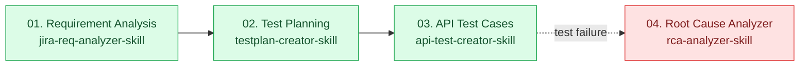

# QA Agent Skills & Test Case Generation Suite

A comprehensive, production-grade collection of **AI Agent Skills for QA Engineers**. Each skill is self-contained with its own `SKILL.md`, standard templates, checklists, and working reference examples, empowering AI coding agents (**Antigravity**, **Claude Code**, **Cursor**, **Codex**, and **GitHub Copilot**) to execute across the Software Testing Life Cycle (STLC) focusing on **API** validation.

> 🏦 **System Under Test (SUT):** This suite is linked and verified against the live [ParaBank Banking Application](https://parabank.parasoft.com/parabank/index.htm) ([API Docs / Swagger](https://parabank.parasoft.com/parabank/api-docs/index.html)).  
> 🔗 **Parent Workspace:** Integrated with the [ParaBank Playwright Automation Framework](../README.md).



> 🟢 **All design skills are production-ready**, and failure diagnosis is handled by the production-ready **RCA skill**. All adhere to the **RICE-POT Prompt Engineering Framework** (Role, Instructions, Context, Example, Parameters, Output, Tone).

---

## 🔗 Quick Links & ParaBank References

| Resource | Description | Link |
|:---|:---|:---|
| **Parent Framework** | Main ParaBank Playwright + TypeScript test suite | [ParaBank Root Framework](../README.md) |
| **Live Web App** | ParaBank demo banking portal | [parabank.parasoft.com](https://parabank.parasoft.com/parabank/index.htm) |
| **Swagger / API Docs** | Official REST endpoint specifications | [ParaBank API Docs](https://parabank.parasoft.com/parabank/api-docs/index.html) |
| **Base API URL** | REST services endpoint prefix | `https://parabank.parasoft.com/parabank/services/bank` |
| **Test Matrix Deliverable** | Complete 8-service API test case specification | [`output/ParaBank_REST_API_Test_Cases.md`](./output/ParaBank_REST_API_Test_Cases.md) |
| **Automated Test Suite** | 22 live automated tests across all 8 microservices | [`tests/api/parabank.spec.ts`](./tests/api/parabank.spec.ts) |

---

## Table of Contents

- [Overview & STLC Architecture](#overview--stlc-architecture)
- [Skills at a Glance](#skills-at-a-glance)
- [Directory Structure](#directory-structure)
- [Detailed Skills Guide](#detailed-skills-guide)
  - [01: JIRA Requirement Analyzer](#01-jira-requirement-analyzer)
  - [02: Test Plan Creator](#02-test-plan-creator)
  - [03: API Test Creator](#03-api-test-creator)
  - [04: Root Cause Analyzer](#04-root-cause-analyzer)
- [ParaBank Live Execution & Test Running](#parabank-live-execution--test-running)
- [MCP & CLI Tooling Integration](#mcp--cli-tooling-integration)
- [Installation & Agent Configuration](#installation--agent-configuration)
- [Creating Custom Skills (RICE-POT Blueprint)](#creating-custom-skills-rice-pot-blueprint)

---

## Overview & STLC Architecture

Traditional chat-based QA prompting suffers from hallucinated requirements, inconsistent test formats, and missing edge cases. This repository provides structured agent skills that give AI agents:
1. **Deterministic Process:** Every task follows established QA standards (IEEE 829, INVEST, Equivalence Partitioning, Boundary Value Analysis).
2. **Built-in Quality Gates:** Mandatory Human Review Gates and deduplication engines prevent bloated or false-positive artifacts.
3. **Traceability:** Every test case and plan traces directly back to requirements, user stories, and acceptance criteria.

---

## Skills at a Glance

| # | Skill | STLC Phase | Trigger Examples | Key Deliverable |
|:---:|:---|:---|:---|:---|
| **01** | [`jira-req-analyzer-skill`](./jira-req-analyzer-skill/SKILL.md) | Requirement Analysis | *"analyze this JIRA story"*, *"is this ticket ready to test?"* | Readiness scorecard, gap & ambiguity analysis |
| **02** | [`testplan-creator-skill`](./testplan-creator-skill/SKILL.md) | Test Planning | *"create test plan for this PRD"*, *"generate test plan"* | Enterprise Test Plan (IEEE 829 compliant) |
| **03** | [`api-test-creator-skill`](./api-test-creator-skill/SKILL.md) | API Test Design | *"write API test cases"*, *"test these REST endpoints"* | API Test Case Matrix + Playwright automation |
| **04** | [`rca-analyzer-skill`](./rca-analyzer-skill/SKILL.md) | Failure Diagnosis | *"why did this test fail?"*, *"analyze this failure"* | Evidence-backed Root Cause Report (`RCA-<LAYER>-<NN>`) |

---

## Directory Structure

```text
api-test-case-generation/
├── README.md                               # Master documentation
├── SKILL.md                                # Root orchestrator skill (routes to sub-skills)
├── skill-template.md                       # Blueprint for authoring new skills (RICE-POT)
│
├── jira-req-analyzer-skill/                # 01: Requirement Analysis & Grooming
│   ├── SKILL.md                            # Analysis instructions & Human Review Gate
│   ├── template.md                         # Requirement Readiness Report template
│   └── examples/
│       └── sample-jira-analysis.md         # Reference e-commerce checkout analysis
│
├── testplan-creator-skill/                 # 02: Enterprise Test Planning
│   ├── SKILL.md                            # Comprehensive Test Plan instructions
│   ├── template.md                         # IEEE 829 test plan template
│   └── Test PlanExample.pdf                # Reference plan: Restful Booker API
│
├── api-test-creator-skill/                 # 03: API / Backend Test Case Design
│   ├── SKILL.md                            # API test design & Playwright automation
│   ├── template.md                         # API Test Case Matrix template
│   ├── templates/
│   │   └── playwright.config.ts            # Ready-to-use Playwright API config
│   ├── references/
│   │   ├── api-testing-checklist.md        # Methods, headers, status codes & auth
│   │   ├── boundary-edge-case-checklist.md # Boundary & edge cases
│   │   └── deduplication-rules.md          # Anti-bloat rules
│   └── examples/
│       └── restful-booker.spec.ts          # Working Playwright TypeScript API tests
│
├── rca-analyzer-skill/                     # 04: Root Cause Analysis Agent
│   ├── SKILL.md                            # RCA agent prompt, workflow & classification
│   ├── template.md                         # Root Cause Report template
│   ├── references/
│   │   ├── rca-checklist.md                # Triage, falsification & classification guide
│   │   └── layer-evidence-checklist.md     # Layer-specific evidence checklists
│   └── examples/
│       └── sample-rca-reports.md           # Worked API RCA examples
│
├── references/                             # Shared Global Checklists
│   ├── qa-coverage-checklist.md            # Broad QA coverage categories
│   ├── boundary-edge-case-checklist.md     # Input validation prompts
│   └── deduplication-rules.md              # 6 rules to prevent test bloat
│
├── assets/                                 # Shared Templates
│   └── default-test-case-template.md       # Standard test case table format
│
├── examples/                               # Shared Reference Outputs
│   └── sample-output.md                    # Compact example of final output style
│
├── tests/                                  # Automated Test Suites
│   └── api/
│       └── parabank.spec.ts                # ParaBank REST API automated tests
│
└── output/                                 # Generated Deliverables
    └── ParaBank_REST_API_Test_Cases.md     # ParaBank 8-service API test cases
```

---

## Detailed Skills Guide

### 01: JIRA Requirement Analyzer
- **Folder:** [`jira-req-analyzer-skill/`](./jira-req-analyzer-skill/)
- **Purpose:** Ingests JIRA user stories, PRDs, and acceptance criteria to perform ambiguity, edge case, and testability gap analysis before writing tests.

### 02: Test Plan Creator
- **Folder:** [`testplan-creator-skill/`](./testplan-creator-skill/)
- **Purpose:** Turns a PRD or feature spec into an enterprise-ready Test Plan (IEEE 829 / ISO 29119).

### 03: API Test Creator
- **Folder:** [`api-test-creator-skill/`](./api-test-creator-skill/)
- **Purpose:** Generates manual API test cases and optional Playwright TypeScript automation scripts.

### 04: Root Cause Analyzer
- **Folder:** [`rca-analyzer-skill/`](./rca-analyzer-skill/)
- **Purpose:** Diagnoses failed API tests from error details and artifacts, separating product defects from test, environment, data, and flakiness issues.

---

## 🏦 ParaBank Live Execution & Test Running

The suite includes an end-to-end automated Playwright test suite for all 8 ParaBank REST microservices:

```bash
# Run tests directly inside api-test-case-generation/
npm test

# Run tests from the parent ParaBank workspace root
npm run test:generation

# View HTML Test Execution Report
npm run report
```

### Verified Coverage

- 8 Microservices Tested: Database, Misc, Customers, Accounts, Transactions, Loans, Positions, JMS
- Total Automated Tests: 22 passed (100% success rate against live ParaBank API)
- Test Spec: [`tests/api/parabank.spec.ts`](./tests/api/parabank.spec.ts)
- Generated Specification: [`output/ParaBank_REST_API_Test_Cases.md`](./output/ParaBank_REST_API_Test_Cases.md)

---

## Installation & Agent Configuration

### Antigravity
This repository is directly loaded in your Antigravity workspace. Agents automatically discover skills via their `SKILL.md` frontmatter descriptions.

### Claude Code
```bash
mkdir -p ~/.claude/skills
cp -r jira-req-analyzer-skill ~/.claude/skills/
cp -r testplan-creator-skill ~/.claude/skills/
cp -r api-test-creator-skill ~/.claude/skills/
cp -r rca-analyzer-skill ~/.claude/skills/
```

### Cursor & GitHub Copilot
Open this repository in Cursor or VS Code. In chat, @mention the skill directory:
```text
@jira-req-analyzer-skill Analyze this user story: [paste story]
@testplan-creator-skill Create a test plan for this PRD: [paste PRD]
@api-test-creator-skill Write API test cases for: [paste endpoint spec]
@rca-analyzer-skill Analyze this test failure: [paste error, stack trace, and artifacts]
```
