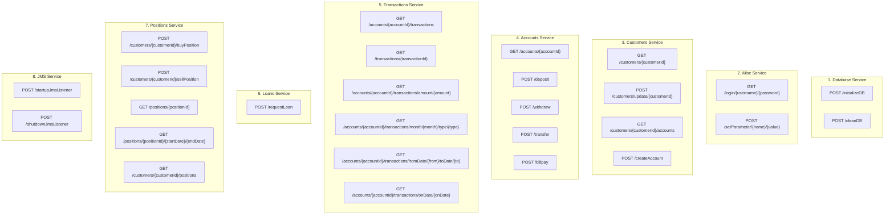

# ParaBank REST API Complete Test Case Specification (Full Service Coverage)

## Document Overview

- **Application Name**: ParaBank REST API
- **Application Type**: RESTful Web Services (JSON / XML)
- **Base URL**: `https://parabank.parasoft.com/parabank/services/bank`
- **Swagger Documentation URL**: `https://parabank.parasoft.com/parabank/api-docs/index.html`
- **Services Covered**: 8 Services (Accounts, Customers, Database, JMS, Loans, Misc, Positions, Transactions)
- **Document Version**: 2.0.0 (Exhaustive Coverage)
- **Framework**: Playwright with TypeScript (`@playwright/test` using `APIRequestContext`)
- **Scope**: Complete end-to-end testing including Positive (Happy Path), Negative (Error Handling), Boundary, Security (Injection / IDOR), Schema Integrity, and Performance SLAs across all 24 API endpoints.

---

## 8 Service Architecture & Endpoint Map



---

## Master Test Execution Matrix (All 8 Services)

| Test Case ID | Test Summary | Service / Tag | Priority | Severity | Test Type | Automation Status | Automated Test Spec |
|---|---|---|---|---|---|---|---|
| **Database Service** | | | | | | | |
| `API-DB-01` | Initialize database to known baseline state | Database | P1 | Critical | Smoke / Functional | Automated | `tests/api/parabank.spec.ts` |
| `API-DB-02` | Idempotent database initialization | Database | P2 | Major | Reliability | Automated | `tests/api/parabank.spec.ts` |
| `API-DB-03` | Clean all database records | Database | P2 | Critical | Functional / Boundary | Planned | `tests/api/parabank.spec.ts` |
| `API-DB-04` | Verify system state after database clean | Database | P2 | Major | Functional | Planned | `tests/api/parabank.spec.ts` |
| **Misc Service** | | | | | | | |
| `API-MISC-01` | Customer login with valid credentials (`john/demo`) | Misc | P1 | Critical | Smoke / Functional | Automated | `tests/api/parabank.spec.ts` |
| `API-MISC-02` | Customer login with invalid password | Misc | P1 | Major | Negative | Automated | `tests/api/parabank.spec.ts` |
| `API-MISC-03` | Customer login with non-existent username | Misc | P2 | Major | Negative | Automated | `tests/api/parabank.spec.ts` |
| `API-MISC-04` | Customer login with empty/whitespace path values | Misc | P2 | Minor | Boundary / Negative | Automated | `tests/api/parabank.spec.ts` |
| `API-MISC-05` | SQL injection attempt in login path parameters | Misc | P1 | Critical | Security | Automated | `tests/api/parabank.spec.ts` |
| `API-MISC-06` | Set valid system runtime parameter (`loanProcessor`) | Misc | P2 | Major | Functional | Automated | `tests/api/parabank.spec.ts` |
| `API-MISC-07` | Set parameter with empty or special character value | Misc | P3 | Minor | Boundary | Automated | `tests/api/parabank.spec.ts` |
| **Customers Service** | | | | | | | |
| `API-CUST-01` | Retrieve customer profile by valid ID (`12212`) | Customers | P1 | Major | Functional | Automated | `tests/api/parabank.spec.ts` |
| `API-CUST-02` | Retrieve customer details with non-existent ID | Customers | P2 | Major | Negative | Automated | `tests/api/parabank.spec.ts` |
| `API-CUST-03` | Retrieve customer with invalid negative/zero ID | Customers | P2 | Minor | Boundary | Automated | `tests/api/parabank.spec.ts` |
| `API-CUST-04` | Update customer profile with complete valid fields | Customers | P1 | Major | Functional | Automated | `tests/api/parabank.spec.ts` |
| `API-CUST-05` | Update customer profile with special characters in address | Customers | P2 | Minor | Boundary | Automated | `tests/api/parabank.spec.ts` |
| `API-CUST-06` | Update customer profile with missing mandatory parameters | Customers | P2 | Major | Negative | Planned | `tests/api/parabank.spec.ts` |
| `API-CUST-07` | Retrieve all accounts for customer (`GET /customers/{id}/accounts`) | Customers | P1 | Critical | Functional | Automated | `tests/api/parabank.spec.ts` |
| `API-CUST-08` | Create account under customer (`POST /createAccount`) | Customers | P1 | Critical | Functional | Automated | `tests/api/parabank.spec.ts` |
| **Accounts Service** | | | | | | | |
| `API-ACCT-01` | Retrieve single account details by valid Account ID (`12345`) | Accounts | P1 | Critical | Smoke / Functional | Automated | `tests/api/parabank.spec.ts` |
| `API-ACCT-02` | Retrieve account details for non-existent Account ID | Accounts | P2 | Major | Negative | Automated | `tests/api/parabank.spec.ts` |
| `API-ACCT-03` | Retrieve account with non-numeric Account ID | Accounts | P3 | Minor | Boundary | Automated | `tests/api/parabank.spec.ts` |
| `API-ACCT-04` | Create new CHECKING account (`newAccountType=0`) | Accounts | P1 | Major | Functional | Automated | `tests/api/parabank.spec.ts` |
| `API-ACCT-05` | Create new SAVINGS account (`newAccountType=1`) | Accounts | P1 | Major | Functional | Automated | `tests/api/parabank.spec.ts` |
| `API-ACCT-06` | Create new LOAN account (`newAccountType=2`) | Accounts | P2 | Major | Functional | Automated | `tests/api/parabank.spec.ts` |
| `API-ACCT-07` | Create account with invalid/unfunded `fromAccountId` | Accounts | P2 | Major | Negative | Automated | `tests/api/parabank.spec.ts` |
| `API-ACCT-08` | Deposit valid positive monetary amount into account | Accounts | P1 | Critical | Functional | Automated | `tests/api/parabank.spec.ts` |
| `API-ACCT-09` | Deposit zero or negative monetary amount | Accounts | P2 | Major | Boundary / Negative | Automated | `tests/api/parabank.spec.ts` |
| `API-ACCT-10` | Withdraw valid amount within available balance | Accounts | P1 | Critical | Functional | Automated | `tests/api/parabank.spec.ts` |
| `API-ACCT-11` | Withdraw amount exceeding balance (overdraft check) | Accounts | P2 | Major | Business Rule | Planned | `tests/api/parabank.spec.ts` |
| `API-ACCT-12` | Transfer funds between two distinct customer accounts | Accounts | P1 | Critical | Functional / E2E | Automated | `tests/api/parabank.spec.ts` |
| `API-ACCT-13` | Transfer funds where source and target accounts are identical | Accounts | P2 | Minor | Boundary / Negative | Automated | `tests/api/parabank.spec.ts` |
| `API-ACCT-14` | Transfer zero or negative funds | Accounts | P2 | Major | Boundary / Negative | Automated | `tests/api/parabank.spec.ts` |
| `API-ACCT-15` | Bill pay with valid Payee JSON payload | Accounts | P1 | Critical | Functional | Automated | `tests/api/parabank.spec.ts` |
| `API-ACCT-16` | Bill pay with XML format payload (`Accept/Content-Type: application/xml`) | Accounts | P2 | Major | Format / Schema | Automated | `tests/api/parabank.spec.ts` |
| `API-ACCT-17` | Bill pay with malformed/missing Payee fields | Accounts | P2 | Major | Negative | Planned | `tests/api/parabank.spec.ts` |
| **Transactions Service** | | | | | | | |
| `API-TXN-01` | Retrieve complete transaction list for an account | Transactions | P1 | Major | Functional | Automated | `tests/api/parabank.spec.ts` |
| `API-TXN-02` | Retrieve transaction details by valid Transaction ID | Transactions | P1 | Major | Functional | Automated | `tests/api/parabank.spec.ts` |
| `API-TXN-03` | Retrieve transaction details by non-existent Transaction ID | Transactions | P2 | Minor | Negative | Automated | `tests/api/parabank.spec.ts` |
| `API-TXN-04` | Filter transactions by exact monetary amount (`/amount/{amount}`) | Transactions | P2 | Major | Functional | Automated | `tests/api/parabank.spec.ts` |
| `API-TXN-05` | Filter transactions by non-matching amount (returns empty list) | Transactions | P2 | Minor | Boundary | Automated | `tests/api/parabank.spec.ts` |
| `API-TXN-06` | Filter transactions by Month and Type (`/month/{month}/type/{type}`) | Transactions | P2 | Major | Functional | Automated | `tests/api/parabank.spec.ts` |
| `API-TXN-07` | Filter transactions for `month=All` and `type=All` | Transactions | P2 | Minor | Functional | Automated | `tests/api/parabank.spec.ts` |
| `API-TXN-08` | Filter transactions by date range (`/fromDate/{from}/toDate/{to}`) | Transactions | P2 | Major | Functional | Automated | `tests/api/parabank.spec.ts` |
| `API-TXN-09` | Filter transactions for specific date (`/onDate/{onDate}`) | Transactions | P2 | Major | Functional | Automated | `tests/api/parabank.spec.ts` |
| `API-TXN-10` | Filter transactions with invalid date format string | Transactions | P3 | Minor | Negative / Boundary | Automated | `tests/api/parabank.spec.ts` |
| **Loans Service** | | | | | | | |
| `API-LOAN-01` | Request loan with qualified down payment (20%+) | Loans | P1 | Critical | Functional | Automated | `tests/api/parabank.spec.ts` |
| `API-LOAN-02` | Request loan with insufficient down payment | Loans | P2 | Major | Business Logic | Automated | `tests/api/parabank.spec.ts` |
| `API-LOAN-03` | Request loan with zero down payment | Loans | P2 | Major | Boundary | Automated | `tests/api/parabank.spec.ts` |
| `API-LOAN-04` | Request loan with non-existent source account ID | Loans | P2 | Major | Negative | Automated | `tests/api/parabank.spec.ts` |
| `API-LOAN-05` | Validate LoanResponse schema fields (`loanProviderName`, `approved`) | Loans | P2 | Major | Schema Validation | Automated | `tests/api/parabank.spec.ts` |
| **Positions Service** | | | | | | | |
| `API-POS-01` | Buy stock position with valid shares and price | Positions | P1 | Critical | Functional | Automated | `tests/api/parabank.spec.ts` |
| `API-POS-02` | Retrieve all stock positions for customer | Positions | P1 | Major | Functional | Automated | `tests/api/parabank.spec.ts` |
| `API-POS-03` | Retrieve specific stock position by Position ID | Positions | P1 | Major | Functional | Automated | `tests/api/parabank.spec.ts` |
| `API-POS-04` | Retrieve non-existent stock position by ID | Positions | P2 | Minor | Negative | Automated | `tests/api/parabank.spec.ts` |
| `API-POS-05` | Sell stock position with valid shares | Positions | P1 | Critical | Functional | Automated | `tests/api/parabank.spec.ts` |
| `API-POS-06` | Query stock position historical price points by date range | Positions | P2 | Minor | Functional | Automated | `tests/api/parabank.spec.ts` |
| `API-POS-07` | Buy stock position with zero or negative shares | Positions | P2 | Major | Boundary / Negative | Automated | `tests/api/parabank.spec.ts` |
| **JMS Service** | | | | | | | |
| `API-JMS-01` | Start JMS message listener service | JMS | P1 | Major | Functional | Automated | `tests/api/parabank.spec.ts` |
| `API-JMS-02` | Start JMS listener when already running (idempotency) | JMS | P2 | Minor | Reliability | Automated | `tests/api/parabank.spec.ts` |
| `API-JMS-03` | Shutdown JMS message listener service | JMS | P1 | Major | Functional | Automated | `tests/api/parabank.spec.ts` |
| `API-JMS-04` | Shutdown JMS listener when already stopped (idempotency) | JMS | P2 | Minor | Reliability | Automated | `tests/api/parabank.spec.ts` |
| **Security & Non-Functional** | | | | | | | |
| `API-SEC-01` | IDOR test: Access other customer's accounts without authorization | Security | P1 | Critical | Security | Automated | `tests/api/parabank.spec.ts` |
| `API-SEC-02` | Response Header Security (`X-Content-Type-Options: nosniff`) | Security | P2 | Major | Security | Automated | `tests/api/parabank.spec.ts` |
| `API-PERF-01` | Verify latency SLA on read inquiries (< 1000ms) | Performance | P3 | Minor | Performance | Automated | `tests/api/parabank.spec.ts` |
| `API-PERF-02` | Verify latency SLA on transactional mutations (< 2000ms) | Performance | P3 | Minor | Performance | Automated | `tests/api/parabank.spec.ts` |

---

## Detailed API Test Cases (Grouped by Service)

### Service 1: Database Operations

#### API-DB-01: Initialize Database to Known Baseline State
- **Test Objective**: Ensure database resets all customer records, initial balances, and default seed positions.
- **Priority**: P1 (High) | **Severity**: Critical | **Test Type**: Smoke / Functional
- **Endpoint**: `POST /initializeDB`
- **Preconditions**: Base URL reachable.
- **Request Details**:
  - **Headers**: `Accept: application/json`
  - **Body**: N/A
- **Test Steps**:
  1. Send `POST /initializeDB`.
  2. Verify response status code.
- **Expected Results**:
  1. HTTP Status `200 OK` or `204 No Content`.
  2. Subsequent login with `john/demo` succeeds.
- **Automated Mapping**: `tests/api/parabank.spec.ts`

#### API-DB-03: Clean All Database Records
- **Test Objective**: Verify cleanDB endpoint purges active records for testing clean-state behavior.
- **Priority**: P2 (Medium) | **Severity**: Critical | **Test Type**: Functional / Boundary
- **Endpoint**: `POST /cleanDB`
- **Preconditions**: Database currently initialized.
- **Request Details**:
  - **Headers**: `Accept: application/json`
- **Test Steps**:
  1. Send `POST /cleanDB`.
  2. Verify HTTP response status.
- **Expected Results**:
  1. HTTP Status `200 OK`.
- **Automated Mapping**: `tests/api/parabank.spec.ts`

---

### Service 2: Misc Operations

#### API-MISC-01: Customer Login With Valid Credentials (`john/demo`)
- **Test Objective**: Verify authenticating valid customer returns 200 and complete customer demographic payload.
- **Priority**: P1 (High) | **Severity**: Critical | **Test Type**: Smoke / Functional
- **Endpoint**: `GET /login/{username}/{password}`
- **Preconditions**: Database initialized.
- **Request Details**:
  - **Headers**: `Accept: application/json`
  - **Path Params**: `username: john`, `password: demo`
- **Test Steps**:
  1. Send `GET /login/john/demo`.
  2. Validate JSON response schema and field types.
- **Expected Results**:
  1. HTTP Status `200 OK`.
  2. Body matches `Customer` schema:
     - `id`: `12212` (integer)
     - `firstName`: `"John"`
     - `lastName`: `"Smith"`
     - `address.street`: `"1431 Main St"`
     - `address.city`: `"Beverly Hills"`
     - `address.state`: `"CA"`
     - `address.zipCode`: `"90210"`
     - `phoneNumber`: `"310-447-4121"`
     - `ssn`: `"622-11-9999"`
- **Automated Mapping**: `tests/api/parabank.spec.ts`

#### API-MISC-02: Customer Login With Invalid Password
- **Test Objective**: Verify entering invalid password returns 400 Bad Request error message.
- **Priority**: P1 (High) | **Severity**: Major | **Test Type**: Negative
- **Endpoint**: `GET /login/{username}/{password}`
- **Request Details**:
  - **Headers**: `Accept: application/json`
  - **Path Params**: `username: john`, `password: wrongpass`
- **Test Steps**:
  1. Send `GET /login/john/wrongpass`.
- **Expected Results**:
  1. HTTP Status `400 Bad Request`.
  2. Response text contains `"Invalid username and/or password"`.
- **Automated Mapping**: `tests/api/parabank.spec.ts`

#### API-MISC-05: SQL Injection Attempt in Login Path Parameters
- **Test Objective**: Verify SQL injection string does not bypass authentication or trigger 500 SQL syntax errors.
- **Priority**: P1 (High) | **Severity**: Critical | **Test Type**: Security
- **Endpoint**: `GET /login/{username}/{password}`
- **Request Details**:
  - **Headers**: `Accept: application/json`
  - **Path Params**: `username: ' OR 1=1 --`, `password: test`
- **Test Steps**:
  1. Send `GET /login/%27%20OR%201%3D1%20--/test`.
- **Expected Results**:
  1. HTTP Status `400 Bad Request` or `404 Not Found`.
  2. No SQL/Hibernate stack trace disclosed.
- **Automated Mapping**: `tests/api/parabank.spec.ts`

#### API-MISC-06: Set Valid System Runtime Parameter (`loanProcessor`)
- **Test Objective**: Verify setting backend configuration parameters via REST endpoint.
- **Priority**: P2 (Medium) | **Severity**: Major | **Test Type**: Functional
- **Endpoint**: `POST /setParameter/{name}/{value}`
- **Request Details**:
  - **Headers**: `Accept: application/json`
  - **Path Params**: `name: loanProcessor`, `value: funds`
- **Test Steps**:
  1. Send `POST /setParameter/loanProcessor/funds`.
- **Expected Results**:
  1. HTTP Status `200 OK`.
- **Automated Mapping**: `tests/api/parabank.spec.ts`

---

### Service 3: Customers Operations

#### API-CUST-01: Retrieve Customer Profile by Valid ID (`12212`)
- **Test Objective**: Verify retrieval of customer data by Customer ID.
- **Priority**: P1 (High) | **Severity**: Major | **Test Type**: Functional
- **Endpoint**: `GET /customers/{customerId}`
- **Request Details**:
  - **Headers**: `Accept: application/json`
  - **Path Params**: `customerId: 12212`
- **Test Steps**:
  1. Send `GET /customers/12212`.
- **Expected Results**:
  1. HTTP Status `200 OK`.
  2. `id` is `12212`, `firstName` is `"John"`, `lastName` is `"Smith"`.
- **Automated Mapping**: `tests/api/parabank.spec.ts`

#### API-CUST-04: Update Customer Profile With Complete Valid Fields
- **Test Objective**: Verify updating customer address, phone number, and name via POST query parameters.
- **Priority**: P1 (High) | **Severity**: Major | **Test Type**: Functional
- **Endpoint**: `POST /customers/update/{customerId}`
- **Request Details**:
  - **Headers**: `Accept: application/json`
  - **Path Params**: `customerId: 12212`
  - **Query Params**:
    - `firstName=John`
    - `lastName=Smith`
    - `street=777 Financial Blvd`
    - `city=Beverly Hills`
    - `state=CA`
    - `zipCode=90210`
    - `phoneNumber=310-555-9000`
    - `ssn=622-11-9999`
    - `username=john`
    - `password=demo`
- **Test Steps**:
  1. Send `POST /customers/update/12212` with query parameters.
  2. Send `GET /customers/12212` to verify updated values.
- **Expected Results**:
  1. HTTP Status `200 OK`.
  2. Subsequent GET reflects `street: "777 Financial Blvd"`, `phoneNumber: "310-555-9000"`.
- **Automated Mapping**: `tests/api/parabank.spec.ts`

---

### Service 4: Accounts Operations

#### API-ACCT-01: Retrieve Single Account Details by Valid Account ID
- **Test Objective**: Query specific account details and assert properties.
- **Priority**: P1 (High) | **Severity**: Critical | **Test Type**: Smoke / Functional
- **Endpoint**: `GET /accounts/{accountId}`
- **Request Details**:
  - **Headers**: `Accept: application/json`
  - **Path Params**: `accountId: 12345`
- **Test Steps**:
  1. Send `GET /accounts/12345`.
- **Expected Results**:
  1. HTTP Status `200 OK`.
  2. JSON contains `id: 12345`, `customerId: 12212`, `type: "CHECKING"`, and numeric `balance`.
- **Automated Mapping**: `tests/api/parabank.spec.ts`

#### API-ACCT-04: Create New Account (Checking, Savings, Loan)
- **Test Objective**: Verify new account creation under customer with different account types.
- **Priority**: P1 (High) | **Severity**: Critical | **Test Type**: Functional
- **Endpoint**: `POST /createAccount`
- **Request Details**:
  - **Headers**: `Accept: application/json`
  - **Query Params**: `customerId=12212&newAccountType=1&fromAccountId=12345` (0=CHECKING, 1=SAVINGS, 2=LOAN)
- **Test Steps**:
  1. Send `POST /createAccount?customerId=12212&newAccountType=1&fromAccountId=12345`.
  2. Inspect response account entity.
- **Expected Results**:
  1. HTTP Status `200 OK`.
  2. Body contains new `id`, `customerId: 12212`, `type: "SAVINGS"`.
- **Automated Mapping**: `tests/api/parabank.spec.ts`

#### API-ACCT-08: Deposit Positive Monetary Amount Into Account
- **Test Objective**: Verify deposit increases account balance and produces success notification.
- **Priority**: P1 (High) | **Severity**: Critical | **Test Type**: Functional
- **Endpoint**: `POST /deposit`
- **Request Details**:
  - **Headers**: `Accept: application/json`
  - **Query Params**: `accountId=12345&amount=250.00`
- **Test Steps**:
  1. Record current balance of account `12345`.
  2. Send `POST /deposit?accountId=12345&amount=250.00`.
  3. Verify message and updated balance.
- **Expected Results**:
  1. HTTP Status `200 OK`.
  2. Response confirms: `"Successfully deposited $250.00 to account #12345"`.
- **Automated Mapping**: `tests/api/parabank.spec.ts`

#### API-ACCT-10: Withdraw Valid Amount Within Available Balance
- **Test Objective**: Verify withdrawal deducts from account balance.
- **Priority**: P1 (High) | **Severity**: Critical | **Test Type**: Functional
- **Endpoint**: `POST /withdraw`
- **Request Details**:
  - **Headers**: `Accept: application/json`
  - **Query Params**: `accountId=13122&amount=50.00`
- **Test Steps**:
  1. Send `POST /withdraw?accountId=13122&amount=50.00`.
- **Expected Results**:
  1. HTTP Status `200 OK`.
  2. Message confirms: `"Successfully withdrew $50.00 from account #13122"`.
- **Automated Mapping**: `tests/api/parabank.spec.ts`

#### API-ACCT-12: Transfer Funds Between Two Distinct Customer Accounts
- **Test Objective**: Verify debit from source account and credit to destination account.
- **Priority**: P1 (High) | **Severity**: Critical | **Test Type**: Functional / E2E
- **Endpoint**: `POST /transfer`
- **Request Details**:
  - **Headers**: `Accept: application/json`
  - **Query Params**: `fromAccountId=13122&toAccountId=12567&amount=75.00`
- **Test Steps**:
  1. Send `POST /transfer?fromAccountId=13122&toAccountId=12567&amount=75.00`.
- **Expected Results**:
  1. HTTP Status `200 OK`.
  2. Message confirms: `"Successfully transferred $75.00 from account #13122 to account #12567"`.
- **Automated Mapping**: `tests/api/parabank.spec.ts`

#### API-ACCT-15: Bill Pay With Valid Payee JSON Payload
- **Test Objective**: Verify bill payment using nested Payee address object.
- **Priority**: P1 (High) | **Severity**: Critical | **Test Type**: Functional
- **Endpoint**: `POST /billpay`
- **Request Details**:
  - **Headers**: `Content-Type: application/json`, `Accept: application/json`
  - **Query Params**: `accountId=13122&amount=60.00`
  - **Body**:
    ```json
    {
      "name": "Acme Power Co",
      "address": {
        "street": "123 Grid Lane",
        "city": "Dallas",
        "state": "TX",
        "zipCode": "75001"
      },
      "phoneNumber": "214-555-0100",
      "accountNumber": 554433
    }
    ```
- **Test Steps**:
  1. Send `POST /billpay` with params and JSON body.
- **Expected Results**:
  1. HTTP Status `200 OK`.
  2. `BillPayResult` object returned: `payeeName: "Acme Power Co"`, `amount: 60`, `accountId: 13122`.
- **Automated Mapping**: `tests/api/parabank.spec.ts`

---

### Service 5: Transactions Operations

#### API-TXN-01: Retrieve Complete Transaction List for an Account
- **Test Objective**: Retrieve list of historical transactions on an account.
- **Priority**: P1 (High) | **Severity**: Major | **Test Type**: Functional
- **Endpoint**: `GET /accounts/{accountId}/transactions`
- **Request Details**:
  - **Headers**: `Accept: application/json`
  - **Path Params**: `accountId: 12345`
- **Test Steps**:
  1. Send `GET /accounts/12345/transactions`.
- **Expected Results**:
  1. HTTP Status `200 OK`.
  2. Array of transactions returned with `id`, `type`, `date`, `amount`, `description`.
- **Automated Mapping**: `tests/api/parabank.spec.ts`

#### API-TXN-02: Retrieve Transaction Details by Valid Transaction ID
- **Test Objective**: Query specific transaction by ID.
- **Priority**: P1 (High) | **Severity**: Major | **Test Type**: Functional
- **Endpoint**: `GET /transactions/{transactionId}`
- **Request Details**:
  - **Headers**: `Accept: application/json`
  - **Path Params**: `transactionId: 12145`
- **Test Steps**:
  1. Send `GET /transactions/12145`.
- **Expected Results**:
  1. HTTP Status `200 OK`.
  2. `id: 12145`, `accountId: 12345`, `type: "Credit"`, `amount: 300.00`.
- **Automated Mapping**: `tests/api/parabank.spec.ts`

#### API-TXN-04: Filter Transactions by Exact Monetary Amount
- **Test Objective**: Query transactions matching exact amount.
- **Priority**: P2 (Medium) | **Severity**: Major | **Test Type**: Functional
- **Endpoint**: `GET /accounts/{accountId}/transactions/amount/{amount}`
- **Request Details**:
  - **Headers**: `Accept: application/json`
  - **Path Params**: `accountId: 12345`, `amount: 1000`
- **Test Steps**:
  1. Send `GET /accounts/12345/transactions/amount/1000`.
- **Expected Results**:
  1. HTTP Status `200 OK`.
  2. Array returned where all transactions have `amount: 1000.00`.
- **Automated Mapping**: `tests/api/parabank.spec.ts`

#### API-TXN-06: Filter Transactions by Month and Type
- **Test Objective**: Query transactions by month (e.g. `All`, `November`) and type (`Debit`, `Credit`, `All`).
- **Priority**: P2 (Medium) | **Severity**: Major | **Test Type**: Functional
- **Endpoint**: `GET /accounts/{accountId}/transactions/month/{month}/type/{type}`
- **Request Details**:
  - **Headers**: `Accept: application/json`
  - **Path Params**: `accountId: 12345`, `month: All`, `type: Debit`
- **Test Steps**:
  1. Send `GET /accounts/12345/transactions/month/All/type/Debit`.
- **Expected Results**:
  1. HTTP Status `200 OK`.
  2. All returned items have `type: "Debit"`.
- **Automated Mapping**: `tests/api/parabank.spec.ts`

---

### Service 6: Loans Operations

#### API-LOAN-01: Request Loan With Qualified Down Payment (20%+)
- **Test Objective**: Verify loan application approval when down payment is sufficient.
- **Priority**: P1 (High) | **Severity**: Critical | **Test Type**: Functional
- **Endpoint**: `POST /requestLoan`
- **Request Details**:
  - **Headers**: `Accept: application/json`
  - **Query Params**: `customerId=12212&amount=1000&downPayment=250&fromAccountId=13122`
- **Test Steps**:
  1. Send `POST /requestLoan?customerId=12212&amount=1000&downPayment=250&fromAccountId=13122`.
- **Expected Results**:
  1. HTTP Status `200 OK`.
  2. `LoanResponse` object returned with `approved: true`, non-empty `loanProviderName`, and timestamp `responseDate`.
- **Automated Mapping**: `tests/api/parabank.spec.ts`

#### API-LOAN-02: Request Loan With Insufficient Down Payment
- **Test Objective**: Verify loan denial or message when down payment is below criteria.
- **Priority**: P2 (Medium) | **Severity**: Major | **Test Type**: Business Logic
- **Endpoint**: `POST /requestLoan`
- **Request Details**:
  - **Headers**: `Accept: application/json`
  - **Query Params**: `customerId=12212&amount=50000&downPayment=1&fromAccountId=13122`
- **Test Steps**:
  1. Send `POST /requestLoan?customerId=12212&amount=50000&downPayment=1&fromAccountId=13122`.
- **Expected Results**:
  1. HTTP Status `200 OK`.
  2. `approved: false` and explanatory message in `message` field.
- **Automated Mapping**: `tests/api/parabank.spec.ts`

---

### Service 7: Positions (Stock Trading) Operations

#### API-POS-01: Buy Stock Position With Valid Parameters
- **Test Objective**: Verify customer can buy stock shares from available account funds.
- **Priority**: P1 (High) | **Severity**: Critical | **Test Type**: Functional
- **Endpoint**: `POST /customers/{customerId}/buyPosition`
- **Request Details**:
  - **Headers**: `Accept: application/json`
  - **Path Params**: `customerId: 12212`
  - **Query Params**: `accountId=13122&name=Apple%20Inc&symbol=AAPL&shares=5&pricePerShare=175.50`
- **Test Steps**:
  1. Send `POST /customers/12212/buyPosition` with parameters.
- **Expected Results**:
  1. HTTP Status `200 OK`.
  2. Array of positions returned containing `symbol: "AAPL"`, `shares: 5`, `purchasePrice: 175.5`.
- **Automated Mapping**: `tests/api/parabank.spec.ts`

#### API-POS-02: Retrieve All Stock Positions for Customer
- **Test Objective**: Query all owned stock positions for a customer.
- **Priority**: P1 (High) | **Severity**: Major | **Test Type**: Functional
- **Endpoint**: `GET /customers/{customerId}/positions`
- **Request Details**:
  - **Headers**: `Accept: application/json`
  - **Path Params**: `customerId: 12212`
- **Test Steps**:
  1. Send `GET /customers/12212/positions`.
- **Expected Results**:
  1. HTTP Status `200 OK`.
  2. Array of positions returned; each position contains `positionId`, `customerId: 12212`, `symbol`, `shares`, `purchasePrice`.
- **Automated Mapping**: `tests/api/parabank.spec.ts`

#### API-POS-03: Retrieve Specific Stock Position by Position ID
- **Test Objective**: Query single position by ID.
- **Priority**: P1 (High) | **Severity**: Major | **Test Type**: Functional
- **Endpoint**: `GET /positions/{positionId}`
- **Request Details**:
  - **Headers**: `Accept: application/json`
  - **Path Params**: `positionId: 12345`
- **Test Steps**:
  1. Send `GET /positions/12345`.
- **Expected Results**:
  1. HTTP Status `200 OK`.
  2. Position object returned: `positionId: 12345`, `customerId: 12212`, `name: "AMR Corporation"`, `symbol: "AAR"`.
- **Automated Mapping**: `tests/api/parabank.spec.ts`

#### API-POS-05: Sell Stock Position With Valid Shares
- **Test Objective**: Verify selling owned stock shares deposits funds back to account.
- **Priority**: P1 (High) | **Severity**: Critical | **Test Type**: Functional
- **Endpoint**: `POST /customers/{customerId}/sellPosition`
- **Request Details**:
  - **Headers**: `Accept: application/json`
  - **Path Params**: `customerId: 12212`
  - **Query Params**: `accountId=13122&positionId=12345&shares=5&pricePerShare=25.00`
- **Test Steps**:
  1. Send `POST /customers/12212/sellPosition` with parameters.
- **Expected Results**:
  1. HTTP Status `200 OK`.
  2. Returns updated list of positions.
- **Automated Mapping**: `tests/api/parabank.spec.ts`

---

### Service 8: JMS Message Service Operations

#### API-JMS-01: Start JMS Message Listener Service
- **Test Objective**: Verify JMS message listener initializes cleanly.
- **Priority**: P1 (High) | **Severity**: Major | **Test Type**: Functional
- **Endpoint**: `POST /startupJmsListener`
- **Request Details**:
  - **Headers**: `Accept: application/json`
- **Test Steps**:
  1. Send `POST /startupJmsListener`.
- **Expected Results**:
  1. HTTP Status `200 OK`.
- **Automated Mapping**: `tests/api/parabank.spec.ts`

#### API-JMS-03: Shutdown JMS Message Listener Service
- **Test Objective**: Verify JMS message listener can be shut down cleanly.
- **Priority**: P1 (High) | **Severity**: Major | **Test Type**: Functional
- **Endpoint**: `POST /shutdownJmsListener`
- **Request Details**:
  - **Headers**: `Accept: application/json`
- **Test Steps**:
  1. Send `POST /shutdownJmsListener`.
- **Expected Results**:
  1. HTTP Status `200 OK`.
- **Automated Mapping**: `tests/api/parabank.spec.ts`
