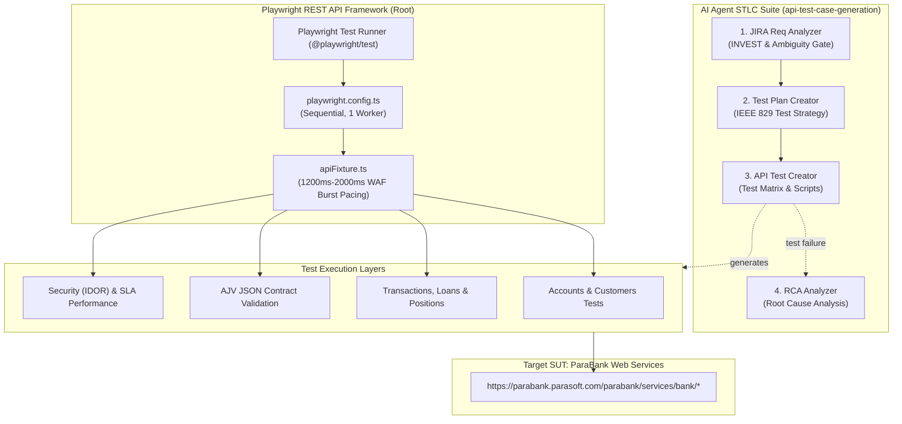
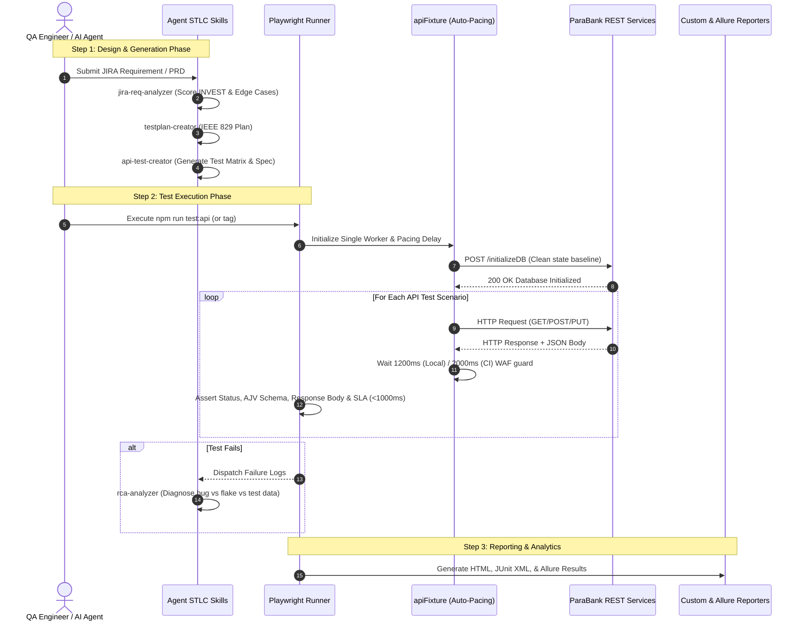

# 🏦 ParaBank REST API Test Automation Framework & Workflow Guide

A comprehensive architectural and workflow specification for the **ParaBank REST API Playwright + TypeScript Automation Framework** and its companion **QA Agent Skills & STLC Suite**.

---

## 📑 Table of Contents

1. [Architecture Overview](#1-architecture-overview)
2. [End-to-End Workflow Diagram](#2-end-to-end-workflow-diagram)
3. [Core Automation Engine (Root Framework)](#3-core-automation-engine-root-framework)
   - [Configuration & Single-Worker Safety](#configuration--single-worker-safety)
   - [Auto-Pacing Fixture & Cloudflare WAF Mitigation](#auto-pacing-fixture--cloudflare-waf-mitigation)
   - [Centralized Endpoint Routing](#centralized-endpoint-routing)
   - [AJV Contract Schema Validation](#ajv-contract-schema-validation)
   - [Security & Performance SLAs](#security--performance-slas)
4. [QA Agent Skills Suite (`api-test-case-generation`)](#4-qa-agent-skills-suite-api-test-case-generation)
   - [01: JIRA Requirement Analyzer](#01-jira-requirement-analyzer-skill)
   - [02: Test Plan Creator](#02-testplan-creator-skill)
   - [03: API Test Creator](#03-api-test-creator-skill)
   - [04: Root Cause Analyzer (RCA)](#04-rca-analyzer-skill)
5. [ParaBank 8 Microservices Test Coverage](#5-parabank-8-microservices-test-coverage)
6. [Test Execution Commands](#6-test-execution-commands)
7. [Reporting & Test Artifacts](#7-reporting--test-artifacts)

---

## 1. Architecture Overview

The workspace is organized into two tightly integrated systems:
1. **The Core Automation Engine (Root)**: Built on `@playwright/test` and TypeScript, providing automated regression, contract validation, security audits, and performance SLA checks directly against ParaBank's live endpoints.
2. **The QA Agent Skills Suite (`api-test-case-generation/`)**: An AI agent-driven STLC pipeline adhering to the **RICE-POT** prompt engineering model (Role, Instructions, Context, Example, Parameters, Output, Tone) for automated requirement analysis, IEEE 829 test plans, test matrix generation, and Root Cause Analysis (RCA).



---

## 2. End-to-End Workflow Diagram



---

## 3. Core Automation Engine (Root Framework)

### Configuration & Single-Worker Safety
* **File**: `playwright.config.ts`
* **Sequential Execution**: Configured with `workers: 1` and `fullyParallel: false`. Banking transactions are inherently stateful (balance transfers, loan down-payments, database initializations); executing tests sequentially eliminates race conditions and balance mutations across concurrent workers.
* **Base URL**: Defaults to `https://parabank.parasoft.com/parabank/services/bank` with environment variable overrides via `.env`.

### Auto-Pacing Fixture & Cloudflare WAF Mitigation
* **File**: `fixtures/apiFixture.ts`
* **Challenge**: Shared public demo instances (like Parasoft's ParaBank) are behind Cloudflare WAF with strict burst rate limiters (Cloudflare Error 1015 / HTTP 429).
* **Solution**: `apiFixture.ts` wraps the base Playwright test and injects an automatic post-test sleep:
  * **1200ms** during local developer runs.
  * **2000ms** during CI pipeline runs.

### Centralized Endpoint Routing
* **File**: `api/endpoints/routes.ts`
* Manages parameter replacement and URL builders for all 8 microservices, ensuring endpoint paths are maintained in a single location.

### AJV Contract Schema Validation
* **Directory**: `api/schemas/` & `tests/api/schemas.spec.ts`
* Uses high-speed `ajv` compiled validators against **JSON Schema Draft-07** specifications:
  * `account_schema.json`
  * `billpay_schema.json`
  * `customer_schema.json`
  * `loan_schema.json`
  * `position_schema.json`
  * `transaction_schema.json`

### Security & Performance SLAs
* **File**: `tests/api/security-performance.spec.ts`
* **Security**: IDOR (Insecure Direct Object Reference) access tests across unauthorized accounts, and header validation (`X-Content-Type-Options`, `Content-Type`).
* **Performance**: Strict SLA assertion where read/inquiry operations must respond in `<1000ms` and state-mutating writes must respond in `<1500ms`.

---

## 4. QA Agent Skills Suite (`api-test-case-generation`)

Located in `api-test-case-generation/`, these modular skills instruct AI agents to autonomously handle the Software Testing Life Cycle (STLC):

| Phase | Skill Folder | Trigger Intent | Output Deliverable |
|:---|:---|:---|:---|
| **01. Requirement Analysis** | `jira-req-analyzer-skill/` | *"Analyze this JIRA ticket / story"* | Requirement Readiness Report, INVEST Score, Ambiguity Gap Analysis |
| **02. Test Planning** | `testplan-creator-skill/` | *"Create test plan for this feature"* | IEEE 829-compliant Enterprise Test Plan |
| **03. API Test Design** | `api-test-creator-skill/` | *"Generate API test cases & scripts"* | API Test Case Matrix (`output/ParaBank_REST_API_Test_Cases.md`) & Playwright spec |
| **04. Failure Diagnosis** | `rca-analyzer-skill/` | *"Why did this test fail? / Analyze RCA"* | Root Cause Analysis Report (`RCA-<LAYER>-<NN>`) |

---

## 5. ParaBank 8 Microservices Test Coverage

| # | Microservice | Spec File | Key Operations Tested |
|:---:|:---|:---|:---|
| **1** | **Database Operations** | Integrated `beforeAll` hooks | `/initializeDB`, `/cleanDB` (data reset baseline) |
| **2** | **Misc Operations** | `tests/api/misc.spec.ts` | `/login/{username}/{password}`, `/setParameter/{name}/{value}`, SQL injection resistance |
| **3** | **Customers** | `tests/api/customers.spec.ts` | `/customers/{id}`, `/customers/update/{id}`, `/customers/{id}/accounts` |
| **4** | **Accounts** | `tests/api/accounts.spec.ts` | Single account lookup, `/deposit`, `/withdraw`, `/transfer`, `/billpay` |
| **5** | **Transactions** | `tests/api/transactions.spec.ts` | `/transactions/{id}`, filter by amount, month, and date range |
| **6** | **Loans** | `tests/api/loans.spec.ts` | `/requestLoan` approval logic, down-payment thresholds, denial paths |
| **7** | **Positions** | `tests/api/positions.spec.ts` | Stock trading `/buyPosition`, `/sellPosition`, `/positions/{id}` |
| **8** | **JMS Messaging** | `tests/api/jms.spec.ts` | Broker queue listener startup and shutdown control |

---

## 6. Test Execution Commands

### Running by Tag Filter
```bash
# Execute entire API suite
npm run test:api

# Execute Sanity / Smoke tests
npm run test:sanity

# Execute Full Master Regression
npm run test:master
npm run test:regression

# Contract JSON Schema verification
npm run test:schema

# Non-functional Security and Performance SLA checks
npm run test:security
npm run test:perf
```

### Running Specific Spec Files
```bash
# Run accounts test spec
npx playwright test tests/api/accounts.spec.ts

# Run loan processing test spec
npx playwright test tests/api/loans.spec.ts
```

### Running with Interactive Debugger & UI
```bash
# Launch interactive Playwright UI
npx playwright test --ui

# Debug mode with step-by-step inspector
npx playwright test --debug
```

### Running Subproject Generator Suite
```bash
# Run the generated 22-endpoint suite
npm run test:generation

# View subproject test report
npm run report:generation
```

---

## 7. Reporting & Test Artifacts

The framework outputs test executions into multiple formats:
* **Playwright HTML Report**: Available in `reports/index.html` (`npx playwright show-report reports`).
* **Custom Reporter Dashboard**: Real-time styled HTML dashboard generated by `utils/CustomReporter.ts` into `custom-report/`.
* **JUnit XML**: Stored at `reports/results.xml` for CI/CD integrations (Jenkins, GitHub Actions, GitLab CI).
* **Allure Reports**: Raw telemetry saved to `allure-results/` for multi-run trending and step timelines.
