# 🔗 ParaBank REST API Collection & API Chaining — v7.0 Plan & Implementation

A complete specification and architectural record for the **ParaBank Postman REST API Collection**, **Environment Variable Architecture**, and **Manual API Chaining Engine** located in the dedicated `postman-collection/` directory.

---

## 📑 Table of Contents

1. [Overview & Scope](#1-overview--scope)
2. [Folder Architecture & Segregation](#2-folder-architecture--segregation)
3. [Postman Collection Architecture (v2.1.0)](#3-postman-collection-architecture-v210)
4. [Environment Variables Architecture](#4-environment-variables-architecture)
5. [The 19 Chaining Requests in Sequence](#5-the-19-chaining-requests-in-sequence)
6. [Manual Testing Workflows in Postman](#6-manual-testing-workflows-in-postman)
7. [Newman Verification & Telemetry](#7-newman-verification--telemetry)

---

## 1. Overview & Scope

The Postman API Collection is specifically created for **manual API testing, exploratory testing, and end-to-end user journey validation using the Postman desktop application or Postman Web**.

It is completely decoupled from the Playwright test automation framework and maintained in its own dedicated folder `postman-collection/`.

Key deliverables:
- **`postman-collection/ParaBank_API_Collection.json`**: Schema v2.1.0 Postman collection with 37+ requests across all 8 microservices and a dedicated End-to-End API Chaining workflow.
- **`postman-collection/ParaBank.postman_environment.json`**: Pre-configured environment variables for base URLs, authentication credentials, test amounts, and dynamic runtime variables.
- **`postman-collection/README.md`**: Step-by-step user guide for importing into Postman, selecting the environment, inspecting variables, and executing manual testing.

---

## 2. Folder Architecture & Segregation

```
ParaBank/
├── postman-collection/                   # 📮 Dedicated Standalone Postman Collection
│   ├── ParaBank_API_Collection.json      # Postman Collection v2.1.0 (8 Services + Chaining)
│   ├── ParaBank.postman_environment.json # Postman Environment (QA + Dynamic Variables)
│   └── README.md                         # Postman import, chaining & manual testing guide
│
├── tests/api/                            # 🎭 Playwright Automation Suites (Completely Separate)
│   ├── accounts.spec.ts
│   ├── customers.spec.ts
│   ├── jms.spec.ts
│   ├── loans.spec.ts
│   ├── misc.spec.ts
│   ├── positions.spec.ts
│   ├── schemas.spec.ts
│   ├── security-performance.spec.ts
│   └── transactions.spec.ts
│
└── package.json                          # Playwright test scripts
```

---

## 3. Postman Collection Architecture (v2.1.0)

Located at `postman-collection/ParaBank_API_Collection.json`:

| Folder | Requests | Description |
| :--- | :---: | :--- |
| **`00 - End-to-End API Chaining Workflow`** | 19 | Complete sequential banking lifecycle with test scripts extracting and chaining runtime variables. |
| **`01 - Database Operations`** | 2 | `/initializeDB` and `/cleanDB`. |
| **`02 - Misc Operations`** | 4 | `/login`, invalid authentication, `/setParameter` for loan processor & provider. |
| **`03 - Customers Operations`** | 3 | `/customers/{id}`, `/customers/update/{id}`, `/customers/{id}/accounts`. |
| **`04 - Accounts Operations`** | 7 | `/accounts/{id}`, `/createAccount` (Checking & Savings), `/deposit`, `/withdraw`, `/transfer`, `/billpay`. |
| **`05 - Transactions Operations`** | 4 | Account transaction inquiries, ID lookup, filtering by amount, month & type. |
| **`06 - Loans Operations`** | 2 | Approved loan (25% down payment) & denial logic. |
| **`07 - Positions Operations`** | 4 | `/buyPosition`, `/sellPosition`, `/positions/{id}`, customer positions. |
| **`08 - JMS Messaging`** | 2 | `/startupJmsListener`, `/shutdownJmsListener`. |

---

## 4. Environment Variables Architecture

Defined in `postman-collection/ParaBank.postman_environment.json`:

### 1. Static Configuration Variables
- `baseUrl`: `https://parabank.parasoft.com/parabank/services/bank`
- `username`: `john`
- `password`: `demo`
- `depositAmount`: `200.00`
- `withdrawAmount`: `25.00`
- `transferAmount`: `50.00`
- `billPayAmount`: `40.00`
- `loanAmount`: `1000`
- `downPayment`: `250`
- `stockSymbol`: `MSFT`
- `stockName`: `Microsoft Corp`
- `stockShares`: `5`
- `stockPrice`: `320.00`

### 2. Dynamic Chained Variables (Populated at Runtime)
- `customerId`: Stored on login (`pm.environment.set("customerId", res.id)`).
- `primaryAccountId`: Stored on account inquiry (`pm.environment.set("primaryAccountId", accounts[0].id)`).
- `secondaryAccountId`: Alternative target account.
- `newAccountId`: Stored on new account opening (`pm.environment.set("newAccountId", res.id)`).
- `transactionId`: Stored on transaction listing (`pm.environment.set("transactionId", txns[0].id)`).
- `positionId`: Stored on stock position buy (`pm.environment.set("positionId", pos.positionId)`).
- `loanAccountId`: Stored on loan approval.

---

## 5. The 19 Chaining Requests in Sequence

```mermaid
flowchart TD
    Init["1. POST /initializeDB<br/>(Clean Baseline State)"] --> Login["2. GET /login/{username}/{password}<br/>(Capture: customerId)"]
    Login --> Cust["3. GET /customers/{customerId}<br/>(Verify KYC Profile)"]
    Cust --> Accts["4. GET /customers/{customerId}/accounts<br/>(Capture: primaryAccountId)"]
    Accts --> CreateAcct["5. POST /createAccount<br/>(Capture: newAccountId)"]
    CreateAcct --> NewAcct["6. GET /accounts/{newAccountId}<br/>(Verify Initial State)"]
    NewAcct --> Deposit["7. POST /deposit<br/>(Deposit $200 into newAccountId)"]
    Deposit --> Transfer["8. POST /transfer<br/>(Transfer $50 newAccountId -> primaryAccountId)"]
    Transfer --> BillPay["9. POST /billpay<br/>(Pay $40 utility bill)"]
    BillPay --> Txns["10. GET /accounts/{newAccountId}/transactions<br/>(Capture: transactionId)"]
    Txns --> TxnDetails["11. GET /transactions/{transactionId}<br/>(Verify Specific Transaction)"]
    TxnDetails --> FilterTxn["12. GET /transactions/amount/50.00<br/>(Verify Amount Filter)"]
    FilterTxn --> Loan["13. POST /requestLoan<br/>(Capture: loanAccountId)"]
    Loan --> BuyStock["14. POST /customers/{customerId}/buyPosition<br/>(Capture: positionId)"]
    BuyStock --> PosDetails["15. GET /positions/{positionId}<br/>(Verify MSFT Position)"]
    PosDetails --> SellStock["16. POST /customers/{customerId}/sellPosition<br/>(Liquidate Shares)"]
    SellStock --> JMS["17. POST /startupJmsListener & /shutdownJmsListener<br/>(Message Lifecycle)"]
    JMS --> Teardown["18. POST /cleanDB<br/>(Clean Database Baseline)"]
```



---

## 6. Manual Testing Workflows in Postman

1. **Import**: Import `ParaBank_API_Collection.json` and `ParaBank.postman_environment.json`.
2. **Select Environment**: Choose `ParaBank QA Environment` from Postman's top-right dropdown.
3. **Run Requests**:
   - Manually click **Send** on individual requests.
   - Or run the folder via Postman Collection Runner (with a 1000-1200ms delay to respect Cloudflare rate limits).
4. **Environment Quick Look**: Open the eye icon 👁️ in Postman anytime to see runtime variables updated dynamically.

---

## 7. Newman Verification & Telemetry

The collection was verified using Newman CLI to ensure 100% syntactical compliance and zero test assertion failures:
- **Requests Executed**: 19
- **Assertions Executed**: 35
- **Passed**: 35 (100%)
- **Failed**: 0
- **Average Response Time**: 682ms
- **Duration**: ~37.8s (with 1200ms pacing)
